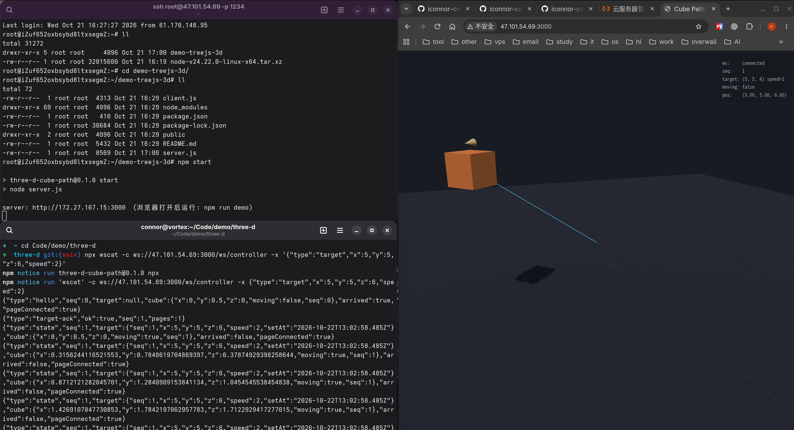
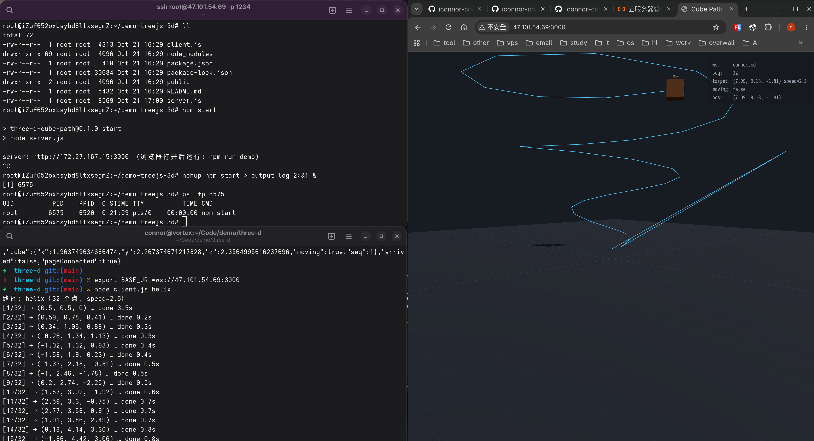
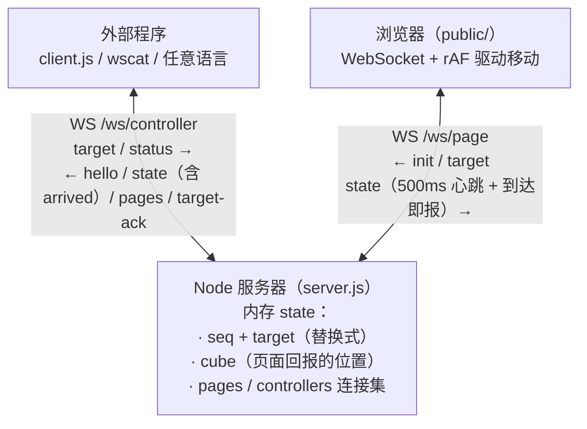

# Three.js 方块路径移动 Demo

3D 场景里有一个方块，外部程序通过 WebSocket 下发「目标位置 + 速度」，方块按给定速度匀速移动到目标点；依次发送一系列路径点，方块即沿这条路径移动。

- 服务器：Node.js（Express + ws），托管页面 + WebSocket 服务，**无构建步骤**
- Three.js 从 npm 安装、由服务器直接托管（不依赖 CDN，不需要 Vite/打包器）
- **外部程序与浏览器统一走 WebSocket**：页面本身仍由 HTTP 静态托管，业务通讯全在 WS 上

## 运行截图
### 1.使用ws客户端发送单个位置


### 2.直接运行客户端测试代码


**说明：服务端部署在阿里云虚拟机，虚拟机内只有局域网IP地址，服务启动后显示的监听地址`172.27.167.15`是B类局域网地址**

## 快速开始

```bash
npm install
npm start         
```

浏览器打开 http://localhost:3000，然后另开终端运行演示脚本：

```bash
npm run demo                 # 正方形路径（5 点，平面）
node client.js spiral        # 螺旋路径（26 点，平面）
node client.js helix         # 螺旋上升（32 点，y 随点上升——三维）
node client.js wave          # 波浪路径（25 点，y 正弦起伏——三维）
```

或手动下发单个目标（任意语言均可，就是个 WebSocket 客户端）：

```bash
# 先进入交互模式
npx wscat -c ws://localhost:3000/ws/controller
# 输入以下坐标、速度：x:左右，y：上下，z：前后
> {"type":"target","x":5,"y":5,"z":-3,"speed":2}
```

不想进交互模式也可一条命令直接发：

```bash
npx wscat -c ws://localhost:3000/ws/controller -x '{"type":"target","x":5,"y":5,"z":-3,"speed":2}'
```

## 架构与数据流



方块位置的**真实值在浏览器端**（requestAnimationFrame 驱动），服务器通过页面回报得知并推送给外部程序。目标为**替换式**：新 target 直接改道，不排队。外部程序**无需轮询**——页面每次回报都会作为 `state` 消息转发，`arrived` 翻转即时可见。

## 协议

所有消息均为 JSON，带 `type` 字段。两个端点按 URL 区分角色：`/ws/page`（浏览器）、`/ws/controller`（外部程序）。

### /ws/controller — 外部程序

连接建立即收到 `hello`（完整状态快照，含 `pageConnected`）。发送：

```json
{ "type": "target", "x": 5, "y": 5, "z": -3, "speed": 2 }
```

- `x/y/z/speed` 均必填、必须有限数字；`speed` 必须 `> 0`（0 速永远到不了，会让等待到达的一方死锁）
- 回复 `target-ack`：成功 `{"type":"target-ack","ok":true,"seq":12,"pages":1}`；违规 `{"ok":false,"error":"…"}`
- `{"type":"status"}` 可随时拉取快照（正常情况靠推送即可，不必发）

接收：

- `state` — 状态**有变化才推送**（位置取整到 3 位 + moving/seq/arrived 联合判定；空闲心跳不刷屏）：`{"type":"state","seq":13,"target":{…},"cube":{…},"arrived":false,"pageConnected":true}`
  - `arrived`：目标为空视为已到达；否则要求页面回报"已执行到最新 seq 且 `moving=false`"（seq 对齐消除"下发后页面还没收到目标就被误报到达"的竞态）
- `pages` — 页面连接数变化：`{"type":"pages","count":0}` 表示浏览器掉线

### /ws/page — 浏览器页面

连接建立即收 `init`（携带当前目标快照，断线重连不丢目标），之后每个新目标推一条 `target`。页面按 `seq` 去重，重放不会造成状态回退。页面发送：

```json
{ "type": "state", "x": 1.2, "y": 0.5, "z": 0.4, "moving": true, "seq": 13 }
```

500ms 心跳 + 到达即报；`seq` 为已应用的最大目标序号。

## 场景说明

深色地面网格（40×40）、半球光 + 方向光（含阴影）、橙色方块（顶部小锥指示朝向）、
目标点小球 + 目标→地面垂直参考线 + 地面投影脉动圆环、方块→目标连线、移动轨迹线（蓝色）。
OrbitControls 拖拽旋转视角。

## 已知取舍

- 状态存服务器单进程内存：**服务器重启后目标清零**，页面收 `init.target=null` 原地待命
- 设计为**单控制页面**：多开标签页时各自连 WS、动作基本同步，`state` 回报取 last-writer-wins
- 页面切到后台时 rAF 暂停、方块停走：演示脚本会按"段超时"报错退出（行为可诊断）
- 服务器每 30s ping 一次空闲连接；页面断线后 2s 自动重连、外部程序掉线需自行重连
- `speed=0` 不代表"急停"而被直接拒绝；如需急停语义应加独立的 stop 消息
- 无碰撞检测：`y < 0.5` 的目标会让方块插入地面（0.5 为方块半高），自带路径均 ≥ 0.5

## 依赖

Node.js ≥ 18。运行时依赖仅 `express`、`ws` 与 `three`（`ws` 同时供 server 与 client.js 使用）。
